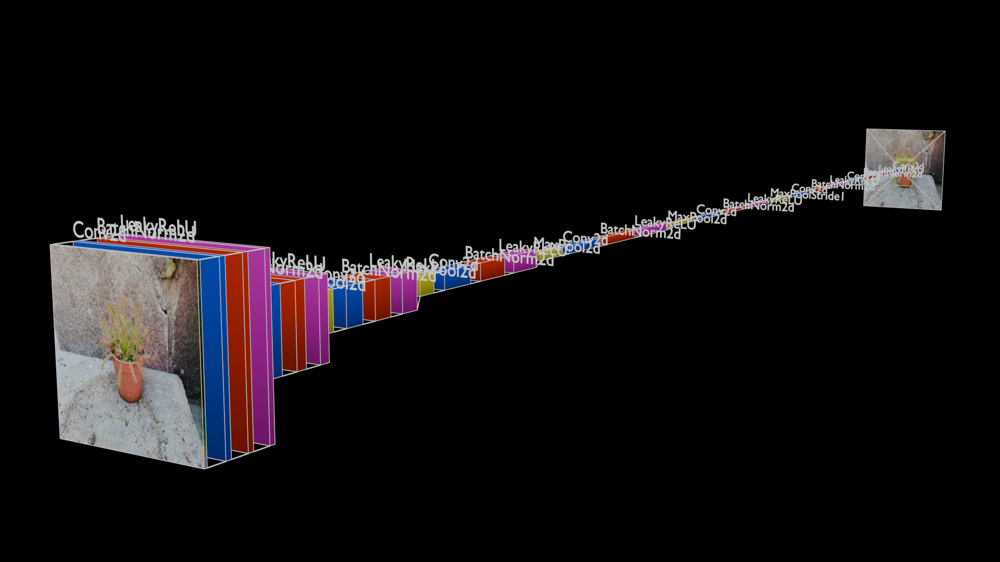
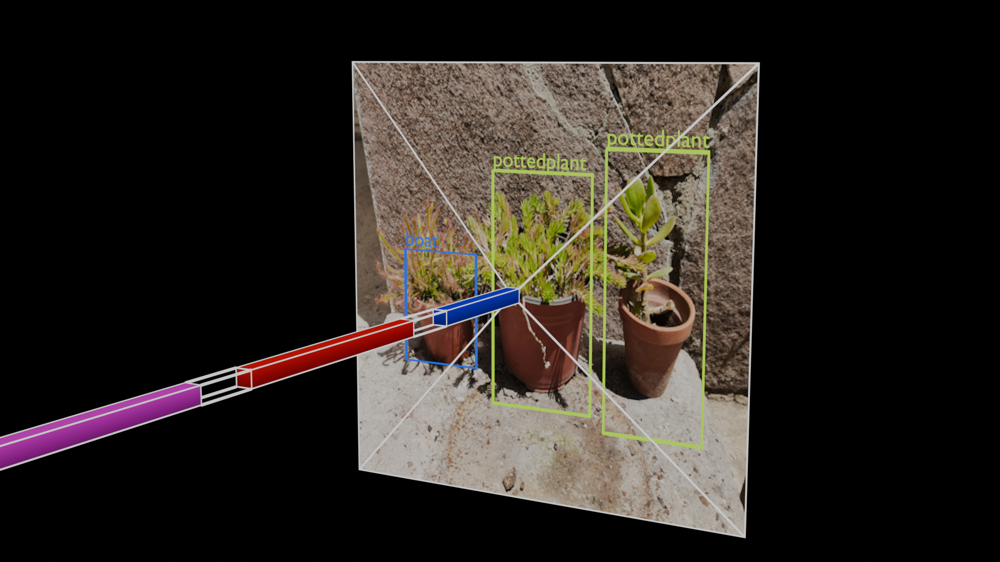
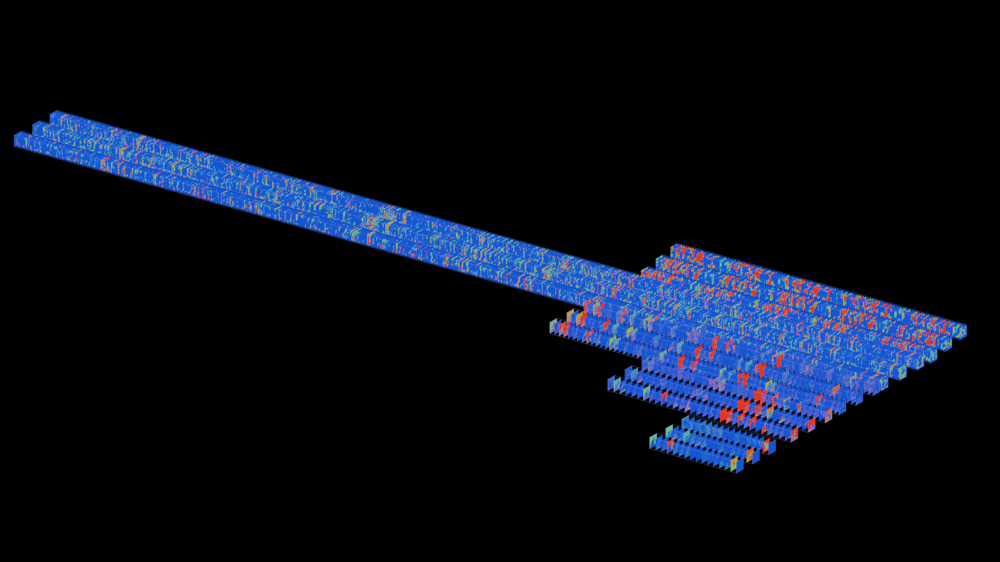
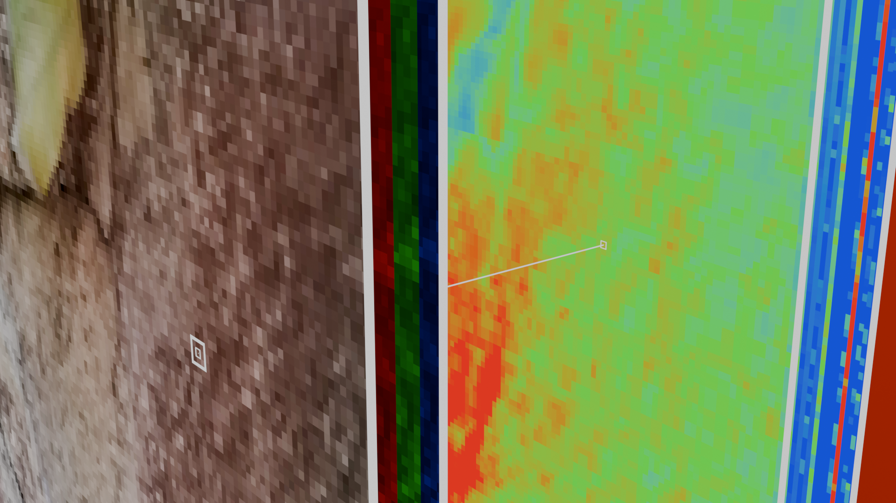

# Sistema Automatizado de Visualización Tridimensional de YOLOv8
**Por Ricardo Sánchez Pérez**

Este repositorio es el espacio de trabajo para el desarrollo de la tesis con titulo provisional:

> *Sistema Automatizado de Visualización Tridimensional Interactiva para la Interpretación de Redes Neuronales Convolucionales utilizando Python y Blender aplicado al Modelo YOLOv2*

Adicionalmente contiene los archivos anexos de librerías compiladas requeridas, estudios de caso y pruebas de rendimiento.

## Estructura del proyecto
El repositorio esta estructurado de la siguiente forma:

- ```src``` Contiene el codigo fuente de los componentes de extracción y visualización.
- ```tesis``` Contiene los archivos para el trabajo escrito de tesis.
- ```anexos``` Contiene archivos complementarios como métricas y estudios de casos. Algunos archivos son omitidos del repositorio, pero incluidos en *Releases*.

## Extracción
### Requisitos
El directorio ```src/componente-extraccion``` contiene el código fuente del componente de extracción. Las librerías de Python requeridas son incluidas en ```requirements.txt```. Adicionalmente requiere la librería de OpenVDB compilada para Python. Las instrucciones de compilación e instalación se encuetran [aquí](anexos/openvdb-lib/openvdb-compilation.md), y las librerías compiladas para Python 3.12 y 3.13 se encuentran para su descarga en *Releases*.

Los pesos de Tiny YOLO se pueden descargar de [aquí](https://data.pjreddie.com/files/yolov2-tiny.weights). El componente espera los pesos en el directorio ```data/weights```.

### Ejecución
Se ejecuta el script ```main.py``` especificando como mínimo la imagen de entrada para la inferencia de la red:

~~~
python main.py --input="path/to/my/image.png"
~~~

Otros parámetros de ejecución incluyen:


| Parametro | Descripción  |
|---------- | ------------------ |
| `--output="path/to/directory"` | Especifica el directorio de salida para los datos extraidos. Por defecto se extraen en el directorio de ejecución.|
| `--layers="Conv2d, MaxPool2d,..."` | Lista separada por comas de los tipos de capa a extraer. Por defecto incluye Conv2D y MaxPool. |
| `--include="cnn.conv1,cnn.conv1,..."` | Lista separada por comas de capas a incluir por nombre en adición a las incluidas por `--layers` |.
| `--exclude="cnn.conv1,cnn.conv2,..."` | Lista separada por comas de capas a excluir por nombre. |
| `--view-layers` | Bandera de depuración que imprime los nombres y tipos de capas, sin realizar inferencias o extracciones. |
| `--dry-run` | Bandera de depuración que ejecuta el proceso de inferencia y extracción sin escribir archivos al disco. |
| `--info` | Bandera de depuración que imprime información de los datos extraidos.
| `--formats="vdb,png,jpg,jpeg,tiff,tif"` | Lista separada por comas de los formatos de salida a extraer. Por defecto solo se usa VDB. |
| `--conf="0.55"` | Umbral de certeza para la inferencia. Por defecto tiene un valor de 0.55. |
| `--nms="0.55"` | Umbral de NMS para la inferencia. Por defecto tiene un valor de 0.55. |

### Datos extraidos
Los datos extraidos son guardados en un directorio conteniendo un archivo ```manifest.json``` con metadatos de las capas extraidas, las imagenes de entrada y salida de la red, las cajas de predicciones, y los datos extraidos de las capas (organizados en folders por formato de salida). No se recomienda modificar la estructura de directorios ni los archivos generados, pues el proceso de importación a Blender asume una estructura específica.

## Visualización
### Requisitos
Se requiere de Blender 5.2 LTS. La extensión se encuentra disponible para su descarga en *Releases*.

### Instalación
En Blender abrir ```Editar > Preferencias > Obtener extensiones ``` y arrastrar a la ventana el archivo .zip de la extensión.

### Uso
Para importar datos, abrir ```Archivo > Importar > YOLOv2 Manifest (.json)``` y en el explorador de archivos seleccionar el archivo ```manifest.json``` extraído por el componente de extracción.

Una vez importado, en el menú lateral del Viewport (en las pestañas laterales junto al gizmo de transformaciones), abrir el menú ```YOLOv2```.

En este menú se puede modificar:

| Parámetro | Descripción |
| --- | --- |
| Escala | Escala de la geometría de la red (Eje X y Y). |
| Escala de Profundidad | Escala de la profundidad de la red (Eje Y). |
| Espaciado | Distancia entre capas de la red. |
| Profundidad Máxima | Distancia máxima entre capas de la red. |
| Visibilidad | Especificar por tipo de capa el color, si utilizar la visualización simplificada, y si mostrar el tipo de la capa. |

Estos parámetros se pueden modificar en cualquier momento para ajustar las disposición general de la geometría de la red.

Finalmente presionar ```Generar Geometría``` para generar la geometría o actualizarla. Descarta cambios realizados individualmente a cada capa.

Adicionalmente, los parámetros individuales de cada capa se pueden modificar en los modificadores de objeto.

## Imágenes









## Video
Introducción a las redes neuronales convolucionales, animado con ayuda de los componentes desarrollados en este proyecto: https://youtu.be/Qev6kNyxNaw